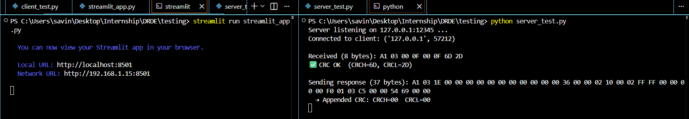
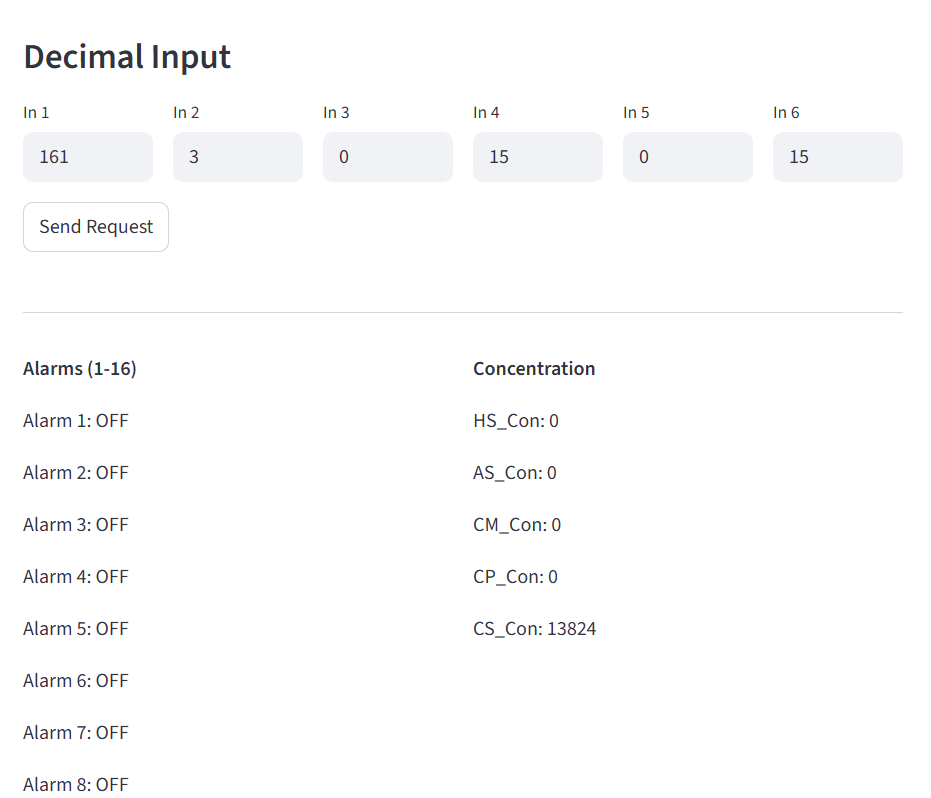
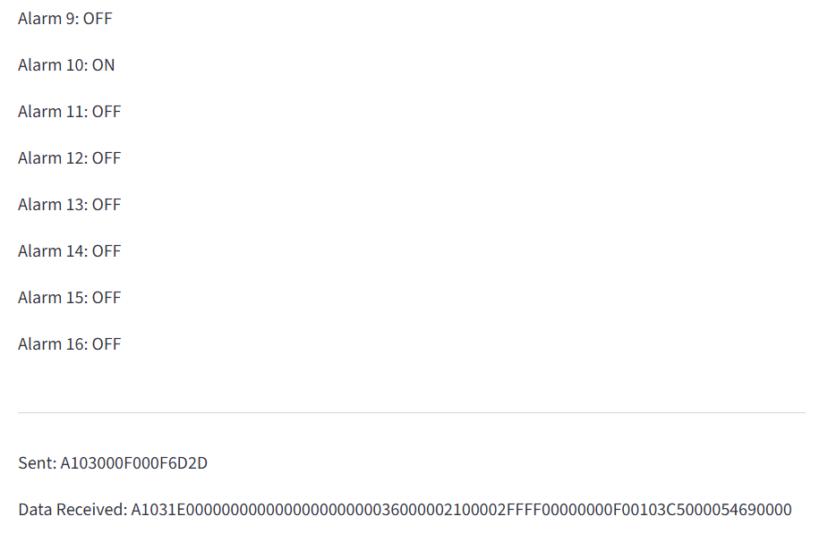

# Client-Server-Socket

Building a  Server & Client socket, using the Socket module, and making them communicate over their respective IPs.

## File Structure

ParentFolder<br>
|<br>
|-server_test.py<br>
|-crc_input.py<br>
|-socket_utils.py<br>
|-streamlit_app.py<br>
|-tests/test_socket_utils.py<br> 

## Install streamlit
use command 
```bash
pip install streamlit
```

## Run

First run the server: 
```bash
python server_test.py
```
Then client:
```bash
streamlit run streamlit_app.py
```

The client sends an 8-byte request (6 data bytes plus CRC) and reads the
37-byte server response (35 data bytes plus CRC). The shared socket helper
handles fragmented TCP reads so incomplete packets are not parsed as complete
responses.

## Tests

The socket framing helper has standard-library unit tests. Run them from the
repository root:

```bash
python -m unittest discover -s tests -v
```

## Terminal View


## User-Interface
 
